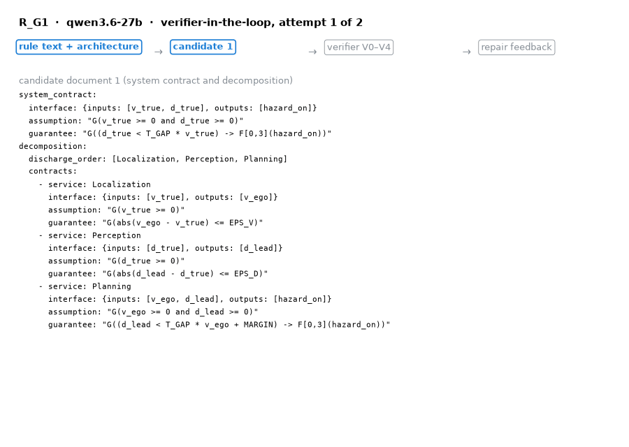
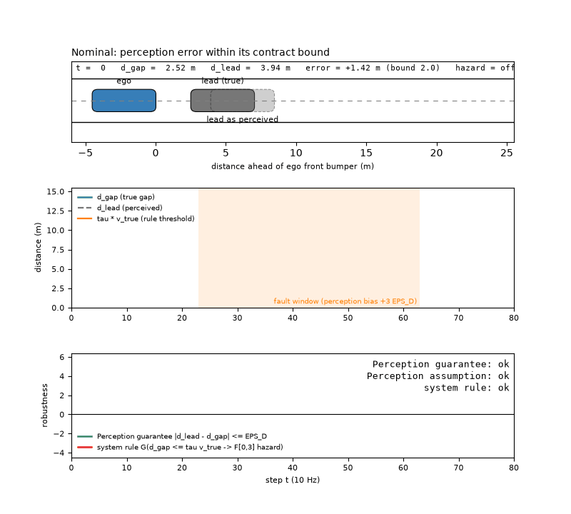

# rules2contracts — From Traffic Rules to Service Contracts

Replication package for the paper *From Traffic Rules to Service Contracts:
LLM-Assisted, Verifier-Gated Contract Synthesis for Automotive
Service-Oriented Architectures* (under review).

The package contains everything needed to **re-check, re-aggregate and
re-monitor** the results reported in the paper without any model access, and
everything needed to **re-run the synthesis** with your own API key or on
your own architecture. It is anonymised for double-blind review.

## Two animations (what the paper does, in motion)

Both GIFs are generated from the recorded data in this package (`make anim`,
scripts `make_anim_repair_loop.py` and `make_anim_fault_localisation.py`;
they need `pip install matplotlib`). They are illustrations, not results:
every number they show is in the result tables under `data/`.

### 1. The verifier coaches the model — `docs/repair_loop.gif`



One recorded synthesis run (`runs/R_G1/qwen3.6-27b/run_2`: the safe-distance
rule, Qwen3.6-27B) as four slides, 4 s each:

1. **Candidate 1.** The model's first rule document: system contract, three
   service contracts (Localisation, Perception, Planning) and the discharge
   order. The strip at the top shows where we are in the loop.
2. **Verifier report for candidate 1.** The checks in pipeline order: YAML,
   Schema, Syntax, V0 (architecture conformance), V1 (well-formedness), V2
   (consistency) all pass; **V3(a) fails** — Planning's assumption
   `G(v_ego >= 0 and d_lead >= 0)` is not discharged by the system assumption
   and the guarantees of its predecessors. The counterexample trace below is
   the proof: `v_true = 0` and `v_ego = −1/4` satisfies Localisation's
   error-bound guarantee `|v_ego − v_true| ≤ EPS_V` and the system assumption,
   yet violates what Planning assumed. This report, verbatim, is the repair
   feedback the model receives (Sect. IV-B); nothing else is.
3. **Candidate 2.** The revised document with the changed line highlighted:
   the assumption now reads `v_ego >= 0 − EPS_V and d_lead >= 0 − EPS_D`, i.e.
   the model has widened it by exactly the error bounds the counterexample
   exposed.
4. **Verifier report for candidate 2.** All checks pass: V3(a) and V3(b)
   prove that the composition of the three service contracts refines the
   system contract, V4 that the decomposition is not vacuous. The document is
   VALID and compiles into one runtime monitor per contract.

The same script animates any recorded run, e.g. a four-attempt failure:
`python3 make_anim_repair_loop.py --run runs/R_G3/mistral-medium-3.5-128b/run_1`.

### 2. The monitors localise the fault before the rule breaks — `docs/fault_localisation.gif`



The episode of Fig. 6 (a recorded US-101 following situation from NGSIM,
`data/fig_fault_localisation.dat`), played at the feature rate of 10 Hz:

* **Top — the situation in the ego frame.** Ego (blue) at the origin, the
  true lead vehicle (grey) at the recorded gap `d_gap`, and a ghost at
  `d_lead`, the gap Perception reports. In the nominal part the ghost sits
  within the contract bound `EPS_D = 2 m` of the true lead; when the
  injected fault starts (orange ghost) Perception over-reports the gap by
  `3·EPS_D = 6 m`. The status line gives the current values, the estimation
  error against its bound, and whether the hazard lights are on.
* **Middle — the signals.** True gap, perceived gap, and the rule threshold
  `τ·v_true`. The orange band is the fault window. The rule premise becomes
  true where the blue curve dips below the orange threshold; from there the
  planner has three steps to raise the hazard. It never does — it sees a
  comfortable (perceived) gap — so the system rule is violated; the red band
  marks the violated interval.
* **Bottom — what the monitors say.** Robustness of the Perception
  guarantee `|d_lead − d_gap| ≤ EPS_D` (green) and of the system rule (red);
  negative means violated. The Perception monitor turns negative at
  **step 23**, the moment the fault starts; the rule breaks only at
  **step 40**. The status panel shows the attribution: Perception's
  guarantee is violated while its assumption holds, so Perception is
  *culpable* (it broke its contract on its own, not because of bad input);
  Localisation and Planning stay clean. A flat, world-level monitor could
  report neither the culprit nor the 17 steps (1.7 s) of early warning.

The monitor over the Perception guarantee compares a feature with an
environment signal (`d_gap`), which is available here because the episode is
a recording; in the vehicle it would need a reference sensor (Sect. V-H).
Planning's contract, by contrast, ranges over features only and is
evaluable online as is.

## What is in here

| Path | Content |
|---|---|
| `stl_ag_checker.py` | The formal core: bounded STL fragment L_safe, assume/guarantee contracts, validity checks V1–V4 (SMT via z3), counterexample extraction, placement metrics |
| `contract_parser.py` | Grammar of the contract DSL used in rule documents → checker AST (rejects everything outside the fragment) |
| `autoware_signatures.yaml` · `autoware_services.py` | The αSOA view of the Autoware reference architecture: components, channels (topics), features with their extraction rules — the architecture context of the paper (Sect. III, Table I, Fig. 2) |
| `check_contracts.py` | CLI: run V0–V4 on a rule document, print verdict, metrics and counterexample traces |
| `contracts/` | The reference rule documents R_G1, R_G2, R_G3, R_I1, R_I3 (transcribed from Maierhofer et al. 2021), the faulty/illegal R_G1 variants of Sect. III-D / Fig. 3, the synthetic few-shot example `SYN_watchdog.yaml`, and `CORPUS.md` (which corpus rules are in/out of scope and why) |
| `llm_pipeline.py` · `llm_config.yaml` | The verifier-in-the-loop synthesis loop (Sect. IV) and the flat baseline (`--baseline`); prompts, repair feedback, response cache |
| `runs/`, `runs_baseline/` | **All 175 + 175 recorded runs**: every candidate document `attempt_k.yaml`, every verifier report (`result.json`), and the response cache of the open-weight models (`_cache/`) |
| `compare_system_contracts.py` | RQ3 fidelity: SMT comparison of synthesised vs. reference system contracts incl. the injective renaming of environment signals |
| `placement_tightness.py` | RQ2 placement and guarantee-slack δ* metrics |
| `monitor_backend.py` · `commonroad_traces.py` · `highd_traces.py` · `run_rq4.py` | RQ4: rtamt monitors compiled from a rule document, feature synthesis with bounded errors and fault injection on recorded traffic, fault localisation sweep |
| `scenarios/` | The NGSIM US-101 recordings in CommonRoad format used in Sect. V-H (see *Data* below) |
| `highd/README.md` | How to obtain the highD recordings (licensed; not redistributable) and reproduce the highD rows |
| `data/` | The canonical result tables (`*_results.csv`), the generated LaTeX macros (`results_macros.tex`) and figure data (`*.dat`) exactly as compiled into the paper |
| `export_figure_data.py` · `make_fig_*.py` | Regenerate every number and every figure data file of the paper from the result tables |
| `replay_checks.py` · `replay_synthesis.sh` · `diff_csv.py` | Reproduction helpers: re-check all recorded candidates; replay the recorded runs from the cache; compare regenerated with canonical tables |
| `autoware_example.py` · `monitor_demo.py` | Self-contained worked examples (Python API, no run records needed) |
| `make_anim_*.py` · `docs/*.gif` | The two README animations and the scripts that generate them from the recorded data |
| `REPRODUCE.md` | Step-by-step reproduction with expected output and runtimes |

## Quick start

```bash
# Python 3.12 (rtamt does not import on 3.13)
python3.12 -m venv .venv
.venv/bin/pip install -r requirements.txt   # no activation needed; make uses .venv automatically

make examples   # check the reference, faulty and illegal R_G1 documents; monitor demo
make replay     # everything offline: re-check 500+ candidates, regenerate the paper's numbers, RQ2/RQ3/RQ4
```

or, without installing anything:

```bash
docker build -t rules2contracts .
docker run --rm rules2contracts            # = make replay
docker run --rm -it rules2contracts bash   # interactive
```

## What can be reproduced, and how

| Paper claim | Reproduced by | Needs |
|---|---|---|
| Every verifier verdict behind Table II, Fig. 5 (V0–V4 on every candidate of every run) | `make check-all` | nothing |
| All numbers in the text (`\res…` macros), Fig. 5 data | `make diff-data` | nothing |
| RQ3 fidelity classes (Sect. V-E), incl. environment-signal alignment | `make rq2` | nothing |
| RQ2 placement and tightness (Sect. V-F) | `make pt` | nothing |
| RQ4 NGSIM fault localisation, 380 monitored runs (Sect. V-H) | `make rq4` | nothing |
| Fig. 3 counterexample trace, Fig. 6 episode | `make figs` | nothing |
| RQ4 highD rows (1 200 + 820 runs) | `run_rq4.py --dataset highd …` | the highD dataset (see `highd/README.md`) |
| The synthesis runs themselves (Sect. V-B–V-D), five open-weight models | `make replay-synthesis` | nothing (responses are in `runs/_cache`) |
| A fresh synthesis batch | `llm_pipeline.py --rule … --model … --run k` | an API key (`LLM_API_KEY`) |

Replaying the open-weight models (`make replay-synthesis`) re-executes the
full loop — prompt → cached response → fresh verifier → repair prompt →
cached response … — and reproduces all 250 recorded run directories
byte-for-byte; `REPRODUCE.md` §6 explains how this stays exact on any
platform although counterexample traces are solver-build dependent. The two
proprietary models were queried through the vendor API; their candidate
documents and verifier reports are included in `runs/`, their raw responses
are not.

A fresh batch (`run_batch.sh`-style loop over rules × models × 5 runs) will
differ from the paper: sampling at temperature 0.2 is not reproducible across
endpoints, and model checkpoints age. The paper's threats-to-validity section
discusses this.

## Running it on your own rule or architecture

1. Describe your architecture in a copy of `autoware_signatures.yaml`
   (components, channels, features with extraction rule and rate).
2. Write a rule document in the format of `contracts/R_G1.yaml` (system
   contract + one contract per service + discharge order + horizon).
3. `python3 check_contracts.py my_rule.yaml` — prints V0–V4 verdicts and, on a
   V3 failure, a counterexample trace.
4. To let a model write the document: set `endpoint` in `llm_config.yaml`,
   `export LLM_API_KEY=…`, then `python3 llm_pipeline.py --rule R_X --model m`.
   Rules are registered in the `RULES` table of `llm_pipeline.py`.

## Data and licences

* Code: MIT (see `LICENSE`).
* `contracts/`, `runs/`, `runs_baseline/`, `data/`: CC BY 4.0. The rule
  texts quoted in the documents are from the German StVO (public law) and
  the formalisations of Maierhofer et al., IV 2021.
* `scenarios/`: CommonRoad scenario files derived from the NGSIM US-101
  dataset (U.S. DOT, public) by the CommonRoad team (TU Munich); redistributed
  unchanged under the CommonRoad scenario licence (BSD-3-Clause); authors and
  provenance are in each file's header.
* highD (Krajewski et al., ITSC 2018) is licensed for research use and may
  not be redistributed; `highd/README.md` explains how to obtain it and
  regenerate the highD tables with the scripts here.
* The response cache contains model outputs produced through an academic
  inference service; no personal data.

## Anonymity

This package is prepared for double-blind review: it contains no author
names, affiliations, endpoint names or credentials. The API key used for the
experiments has been removed from `llm_config.yaml`; set `LLM_API_KEY` to run
new queries. Please do not add identifying information to the anonymised
mirror.
